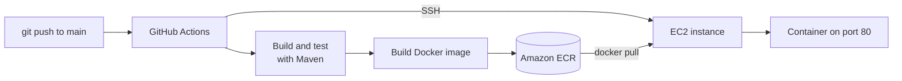

Deploying by hand gets old fast: build the JAR, copy it to the server, SSH in, stop the old process, start the new one, and hope nothing breaks. In this article I'll set up a pipeline that does all of that automatically every time I push to `main`.

By the end, a `git push` will:

1. Build and test the Spring Boot app.
2. Package it as a Docker image.
3. Push the image to **Amazon ECR** (AWS's private container registry).
4. SSH into an **EC2** instance, pull the new image, and swap the running container.
5. Health-check the new version and **roll back automatically** if it doesn't come up.

## How it fits together



A few design choices worth calling out:

- **No AWS access keys in GitHub.** The workflow authenticates to AWS with OpenID Connect (OIDC) and gets short-lived credentials for each run.
- **The EC2 instance pulls from ECR with its own IAM role**, so no AWS credentials are stored on the server either.
- **Every image is tagged with the Git commit SHA**, so you always know exactly which commit is running, and rolling back is just running an older tag.

## Prerequisites

- A Spring Boot app built with Maven, using the Maven wrapper (`mvnw`). Projects generated from [start.spring.io](https://start.spring.io) include it.
- The code in a GitHub repository.
- An AWS account and the AWS CLI configured locally.
- Docker installed locally (to test the image before automating it).

I'm using Java 21 and the `ap-south-1` (Mumbai) region throughout. Swap in your own values where needed.

## Step 1: Add a health endpoint to the app

The deploy step needs a way to tell whether the new version actually started. Spring Boot Actuator provides a `/actuator/health` endpoint that returns HTTP 200 when the app is up. Add the dependency to `pom.xml`:

```xml
<dependency>
    <groupId>org.springframework.boot</groupId>
    <artifactId>spring-boot-starter-actuator</artifactId>
</dependency>
```
{: file="pom.xml" }

The health endpoint is exposed over HTTP by default, so no extra configuration is needed.

## Step 2: Containerize the app

I use a **multi-stage Dockerfile**: the first stage builds the JAR with the full JDK, and the second stage copies only the JAR into a smaller JRE image. The final image doesn't contain Maven, the source code, or the JDK.

```dockerfile
# syntax=docker/dockerfile:1

# ---- Build stage ----
FROM eclipse-temurin:21-jdk AS build
WORKDIR /workspace

# Copy the build files first so dependencies are cached
# as a separate layer and only re-downloaded when pom.xml changes
COPY .mvn/ .mvn/
COPY mvnw pom.xml ./
RUN chmod +x mvnw && ./mvnw -B -q dependency:go-offline

COPY src/ src/
RUN ./mvnw -B -q package -DskipTests

# ---- Runtime stage ----
FROM eclipse-temurin:21-jre
WORKDIR /app

# Don't run the app as root
RUN groupadd --system spring && useradd --system --gid spring spring
USER spring

COPY --from=build /workspace/target/*.jar app.jar

EXPOSE 8080
ENTRYPOINT ["java", "-jar", "app.jar"]
```
{: file="Dockerfile" }

Tests are skipped inside the Docker build (`-DskipTests`) because the pipeline runs them in a separate job before the image is ever built.

Add a `.dockerignore` so local build output and Git history aren't sent to Docker:

```text
target/
.git/
.idea/
*.iml
```
{: file=".dockerignore" }

Test it locally before automating anything:

```bash
docker build -t myapp .
docker run --rm -p 8080:8080 myapp

# In another terminal
curl http://localhost:8080/actuator/health
# {"status":"UP"}
```

## Step 3: Create an ECR repository

ECR stores the images. Create a repository for the app:

```bash
aws ecr create-repository \
  --repository-name myapp \
  --region ap-south-1
```

Since every push creates a new image, it's worth adding a lifecycle policy so ECR keeps only the most recent ones:

```bash
aws ecr put-lifecycle-policy \
  --repository-name myapp \
  --region ap-south-1 \
  --lifecycle-policy-text '{
    "rules": [{
      "rulePriority": 1,
      "description": "Keep the last 10 images",
      "selection": {
        "tagStatus": "any",
        "countType": "imageCountMoreThan",
        "countNumber": 10
      },
      "action": { "type": "expire" }
    }]
  }'
```

## Step 4: Set up the EC2 instance

### Launch the instance

In the EC2 console, launch an instance with:

- **AMI:** Amazon Linux 2023
- **Instance type:** a small **x86_64** type such as `t3.micro` or `t3.small`
- **Security group** inbound rules:
  - **HTTP (80)** from anywhere, for users of the app
  - **SSH (22)** for the deploy step (see the note below)

> GitHub-hosted runners build `linux/amd64` images. If you pick an ARM (Graviton) instance such as `t4g`, the container will fail with `exec format error`. Either stick to x86_64 instances or build an ARM image (for example, by running the job on `ubuntu-24.04-arm`).
{: .prompt-warning }

> GitHub-hosted runners don't have a small, fixed set of IP addresses, so in practice port 22 ends up open to the internet. That's acceptable with key-only authentication (the Amazon Linux default), but if you'd rather close port 22 entirely, see [AWS Systems Manager](#next-steps) under next steps.
{: .prompt-info }

Also allocate an **Elastic IP** and associate it with the instance. Otherwise the public IP changes whenever the instance stops and starts, and the pipeline will lose track of it.

### Give the instance permission to pull from ECR

Create an IAM role for EC2 with the AWS managed policy **`AmazonEC2ContainerRegistryReadOnly`**, then attach it to the instance (**Actions → Security → Modify IAM role**). The instance can now pull images without any stored credentials.

### Install Docker

SSH into the instance and run:

```bash
sudo dnf update -y
sudo dnf install -y docker
sudo systemctl enable --now docker

# Let ec2-user run docker without sudo
sudo usermod -aG docker ec2-user
```

Log out and back in for the group change to apply, then check that Docker and the instance role both work:

```bash
docker ps
aws sts get-caller-identity   # should show the role you attached
```

Amazon Linux 2023 ships with the AWS CLI, so there's nothing else to install.

### Create a deploy key

Rather than giving GitHub the key pair you use yourself, create a dedicated key just for deployments. On your local machine:

```bash
ssh-keygen -t ed25519 -f ec2_deploy_key -N "" -C "github-actions-deploy"
```

Append the **public** key to `~/.ssh/authorized_keys` on the instance:

```bash
# On the EC2 instance
echo "<contents of ec2_deploy_key.pub>" >> ~/.ssh/authorized_keys
```

The **private** key (`ec2_deploy_key`) goes into a GitHub secret in Step 6.

## Step 5: Let GitHub Actions access AWS with OIDC

Instead of creating an IAM user and pasting long-lived access keys into GitHub, I let AWS trust GitHub's OIDC tokens directly. Each workflow run gets temporary credentials that expire on their own.

### Add GitHub as an identity provider

In the IAM console, go to **Identity providers → Add provider** and choose **OpenID Connect**:

- **Provider URL:** `https://token.actions.githubusercontent.com`
- **Audience:** `sts.amazonaws.com`

You only need to do this once per AWS account.

### Create a role for the workflow

Create an IAM role with this **trust policy**. It allows only workflow runs on the `main` branch of your repository to assume the role:

```json
{
  "Version": "2012-10-17",
  "Statement": [
    {
      "Effect": "Allow",
      "Principal": {
        "Federated": "arn:aws:iam::<ACCOUNT_ID>:oidc-provider/token.actions.githubusercontent.com"
      },
      "Action": "sts:AssumeRoleWithWebIdentity",
      "Condition": {
        "StringEquals": {
          "token.actions.githubusercontent.com:aud": "sts.amazonaws.com",
          "token.actions.githubusercontent.com:sub": "repo:<GITHUB_USER>/<REPO>:ref:refs/heads/main"
        }
      }
    }
  ]
}
```
{: file="trust-policy.json" }

Then attach a **permissions policy** that allows pushing to the ECR repository and nothing else:

```json
{
  "Version": "2012-10-17",
  "Statement": [
    {
      "Effect": "Allow",
      "Action": "ecr:GetAuthorizationToken",
      "Resource": "*"
    },
    {
      "Effect": "Allow",
      "Action": [
        "ecr:BatchCheckLayerAvailability",
        "ecr:BatchGetImage",
        "ecr:CompleteLayerUpload",
        "ecr:InitiateLayerUpload",
        "ecr:PutImage",
        "ecr:UploadLayerPart"
      ],
      "Resource": "arn:aws:ecr:ap-south-1:<ACCOUNT_ID>:repository/myapp"
    }
  ]
}
```
{: file="ecr-push-policy.json" }

Note the role's ARN. It looks like `arn:aws:iam::<ACCOUNT_ID>:role/github-actions-deploy`.

## Step 6: Add the secrets to GitHub

In your repository, go to **Settings → Secrets and variables → Actions** and add:

| Name | Type | Value |
|---|---|---|
| `AWS_ROLE_ARN` | Variable | The ARN of the role from Step 5 |
| `EC2_HOST` | Secret | The instance's Elastic IP |
| `EC2_SSH_KEY` | Secret | The full contents of the private key `ec2_deploy_key` |

The role ARN isn't sensitive, so it goes in **Variables** rather than **Secrets**.

## Step 7: Write the pipeline

Here's the full workflow. It has two jobs:

- **`test`** runs on every push and pull request, so broken code is caught before it's merged.
- **`deploy`** runs only on pushes to `main`, and only if the tests passed.


```yaml
name: CI/CD

on:
  push:
    branches: [main]
  pull_request:
    branches: [main]

permissions:
  contents: read

env:
  AWS_REGION: ap-south-1
  ECR_REPOSITORY: myapp
  CONTAINER_NAME: myapp

jobs:
  test:
    runs-on: ubuntu-latest
    steps:
      - uses: actions/checkout@v7

      - uses: actions/setup-java@v6
        with:
          distribution: temurin
          java-version: "21"
          cache: maven

      - name: Build and run tests
        run: ./mvnw -B verify

  deploy:
    needs: test
    if: github.event_name == 'push' && github.ref == 'refs/heads/main'
    runs-on: ubuntu-latest
    # Never run two deployments at the same time
    concurrency:
      group: production-deploy
      cancel-in-progress: false
    permissions:
      contents: read
      id-token: write # required for OIDC
    steps:
      - uses: actions/checkout@v7

      - name: Configure AWS credentials
        uses: aws-actions/configure-aws-credentials@v6
        with:
          role-to-assume: ${{ vars.AWS_ROLE_ARN }}
          aws-region: ${{ env.AWS_REGION }}

      - name: Log in to Amazon ECR
        id: ecr
        uses: aws-actions/amazon-ecr-login@v2

      - name: Build and push image
        id: image
        env:
          IMAGE: ${{ steps.ecr.outputs.registry }}/${{ env.ECR_REPOSITORY }}:${{ github.sha }}
        run: |
          docker build -t "$IMAGE" .
          docker push "$IMAGE"
          echo "image=$IMAGE" >> "$GITHUB_OUTPUT"

      - name: Deploy to EC2
        uses: appleboy/ssh-action@v1
        env:
          IMAGE: ${{ steps.image.outputs.image }}
          AWS_REGION: ${{ env.AWS_REGION }}
          CONTAINER_NAME: ${{ env.CONTAINER_NAME }}
        with:
          host: ${{ secrets.EC2_HOST }}
          username: ec2-user
          key: ${{ secrets.EC2_SSH_KEY }}
          envs: IMAGE,AWS_REGION,CONTAINER_NAME
          script: |
            set -euo pipefail

            # Log in to ECR using the instance's IAM role
            aws ecr get-login-password --region "$AWS_REGION" \
              | docker login --username AWS --password-stdin "${IMAGE%%/*}"
            docker pull "$IMAGE"

            # Remember what's running now, in case we need to roll back
            PREVIOUS=$(docker inspect --format '{{.Config.Image}}' "$CONTAINER_NAME" 2>/dev/null || true)

            start() {
              docker stop "$CONTAINER_NAME" >/dev/null 2>&1 || true
              docker rm "$CONTAINER_NAME" >/dev/null 2>&1 || true
              docker run -d --name "$CONTAINER_NAME" --restart unless-stopped \
                -p 80:8080 \
                -e SPRING_PROFILES_ACTIVE=prod \
                -e JAVA_TOOL_OPTIONS="-XX:MaxRAMPercentage=75" \
                "$1"
            }

            healthy() {
              for _ in $(seq 1 30); do
                curl -fs http://localhost/actuator/health >/dev/null && return 0
                sleep 3
              done
              return 1
            }

            start "$IMAGE"
            if healthy; then
              echo "Deployed $IMAGE"
              # Clean up images older than a week to save disk space
              docker image prune -af --filter "until=168h"
            else
              echo "New version failed its health check. Recent logs:"
              docker logs --tail 100 "$CONTAINER_NAME"
              if [ -n "$PREVIOUS" ]; then
                echo "Rolling back to $PREVIOUS"
                start "$PREVIOUS"
              fi
              exit 1
            fi
```
{: file=".github/workflows/deploy.yml" }


What the deploy script does, step by step:

1. **Logs in to ECR** using the instance's IAM role. `${IMAGE%%/*}` strips everything after the first `/`, leaving just the registry host.
2. **Pulls the new image** before stopping anything, so the old version keeps serving traffic during the download.
3. **Records the currently running image** so it can roll back to it.
4. **Replaces the container.** `--restart unless-stopped` brings it back automatically if the app crashes or the instance reboots. `MaxRAMPercentage=75` lets the JVM size its heap from the memory actually available.
5. **Polls `/actuator/health`** for up to 90 seconds. If the app never reports healthy, it prints the logs, restarts the previous version, and fails the job so you notice.

Commit the workflow and push to `main`. Open the **Actions** tab to watch it run, then visit `http://<your-elastic-ip>/actuator/health`.

## Rolling back manually

Because every image is tagged with its commit SHA, you can go back to any earlier version. The easiest way is to open an older successful run in the **Actions** tab and click **Re-run all jobs**: it rebuilds and redeploys that exact commit.

You can also do it directly on the instance:

```bash
docker stop myapp && docker rm myapp
docker run -d --name myapp --restart unless-stopped -p 80:8080 \
  <ACCOUNT_ID>.dkr.ecr.ap-south-1.amazonaws.com/myapp:<older-commit-sha>
```

## Troubleshooting

| Symptom | Likely cause and fix |
|---|---|
| `./mvnw: Permission denied` in the test job | The wrapper lost its executable bit (common when committed from Windows). Run `git update-index --chmod=+x mvnw` and commit. |
| `Not authorized to perform sts:AssumeRoleWithWebIdentity` | The `sub` condition in the trust policy doesn't match. Check the `<GITHUB_USER>/<REPO>` spelling and branch. If the job uses a GitHub `environment:`, the subject becomes `repo:<GITHUB_USER>/<REPO>:environment:<NAME>` instead. |
| `no basic auth credentials` on `docker pull` | The instance role is missing or doesn't have `AmazonEC2ContainerRegistryReadOnly`. Check with `aws sts get-caller-identity` on the instance. |
| `exec format error` when the container starts | Architecture mismatch: an amd64 image on an ARM instance. See the warning in Step 4. |
| SSH step times out | Port 22 isn't open in the security group, or `EC2_HOST` is outdated. Use an Elastic IP. |
| Health check fails, logs show `OutOfMemoryError` or the container keeps restarting | The instance is too small. Try `t3.small`, or [add swap space](https://repost.aws/knowledge-center/ec2-memory-swap-file) on the instance. |

## Next steps

This setup works well for a personal project or a small internal app. Once it's running, these are the improvements I'd look at next:

- **Zero-downtime deploys.** The container is stopped before the new one starts, so there are a few seconds of downtime. Running two containers behind Nginx, or two instances behind an Application Load Balancer, removes that gap.
- **Close port 22.** Replace the SSH step with [AWS Systems Manager Run Command](https://docs.aws.amazon.com/systems-manager/latest/userguide/run-command.html): the workflow sends the deploy script through the AWS API, so the instance needs no inbound SSH at all.
- **Keep configuration out of the image.** Pass database URLs and passwords to the container from AWS Systems Manager Parameter Store or Secrets Manager instead of baking them in.
- **HTTPS.** Put the app behind Nginx with a Let's Encrypt certificate, or behind a load balancer with a certificate from AWS Certificate Manager.

If this was useful or you hit a snag I didn't cover, let me know.
